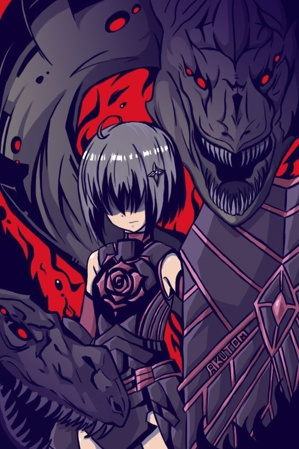

<div align="center">

<!-- ═══════════ HEADER BANNER ═══════════ -->


<!-- ═══════════ TYPING EFFECT ═══════════ -->
<a href="https://git.io/typing-svg">
  
</a>

<br/>

<!-- ═══════════ VISITOR COUNTER ═══════════ -->


</div>

<br/>

<div align="center"> ▰▰▰▰▰▰▰▰▰▰ ◢◤ 🛡️ ◥◣ ▰▰▰▰▰▰▰▰▰▰ </div>

<br/>

<!-- ═══════════ STATUS WINDOW ═══════════ -->
<table align="center" border="0">
<tr>
<td width="38%" valign="middle" align="center">
  
  <br/>
  <sub><b>🍁 Maple — Honjou Kaede 🍁</b></sub>
</td>
<td width="62%" valign="top">

```text
╔═══════════════════════════════════════════════════╗
║              🛡️  STATUS WINDOW  🛡️                ║
╠═══════════════════════════════════════════════════╣
║                                                   ║
║   Player       : ハヤ (影野士道)                    ║
║   Guild        : 楓の木 (Kaede no Ki)              ║
║   Class        : Full-Stack Defender              ║
║   Level        : 19                               ║
║   Username     : @hayaxxdev-bit                   ║
║   Status       : 🟢 Online / Active               ║
║                                                   ║
╠═══════════════ EQUIPMENT ═════════════════════════╣
║                                                   ║
║   OS           : Kubuntu LTS                      ║
║   Shell        : Zsh                              ║
║   Editor       : VSCodium                         ║
║   Browser      : Firefox                          ║
║                                                   ║
╠═══════════════ SKILL TREE ════════════════════════╣
║                                                   ║
║   ◈ Full Stack Development                        ║
║   ◈ Game Development                              ║
║   ◈ Computer Science                              ║
║   ◈ Open Source Contribution                      ║
║                                                   ║
╚═══════════════════════════════════════════════════╝
```

</td>
</tr>
</table>

<div align="center">

### 「防御力に極振りする。」

*Semua stat dialihkan ke DEF — begitu pula caraku membangun sesuatu: perlahan, kokoh, dan tahan lama.*

</div>

<br/>

<div align="center"> ▰▰▰▰▰▰▰▰▰▰ ◢◤ 🩸 ◥◣ ▰▰▰▰▰▰▰▰▰▰ </div>

<br/>

<!-- ═══════════ TERMINAL INTRO ═══════════ -->
<div align="center">

## 〔 `root@kaede-no-ki:~$ whoami` 〕

</div>

```ansi
[hayaxx@kaede-no-ki ~]$ cat about.txt

  > Anime & manga addict  ........ [ MAX LEVEL ]
  > Cyber / neon aesthetic ........ [ ENABLED ]
  > Waifu ......................... Maple (Bofuri) 🍁🛡️
  > Philosophy .................... "Slow, solid, unbreakable."
  > Currently ..................... farming XP: TypeScript, Docker, Godot, CS

[hayaxx@kaede-no-ki ~]$ echo $MOTTO
Learn Together. Build Together. Share Together. Grow Together.

[hayaxx@kaede-no-ki ~]$ _
```

<div align="center"> ▰▰▰▰▰▰▰▰▰▰ ◢◤ 🛡️ ◥◣ ▰▰▰▰▰▰▰▰▰▰ </div>

<br/>

<!-- ═══════════ TECH STACK ═══════════ -->
<div align="center">

## ⚔️ 〔 BUFF AKTIF — TECH STACK 〕

**▸ Languages**
<br/>


**▸ Frontend**
<br/>


**▸ Backend & Database**
<br/>


**▸ DevOps & Tools**
<br/>


</div>

<br/>

<div align="center"> ▰▰▰▰▰▰▰▰▰▰ ◢◤ 🩸 ◥◣ ▰▰▰▰▰▰▰▰▰▰ </div>

<br/>

<!-- ═══════════ QUEST LOG ═══════════ -->
<div align="center">

## 📜 〔 QUEST LOG — PROYEK SAAT INI 〕

<!--QUEST_LOG:START-->

<!--QUEST_LOG:END-->

</div>

<br/>

<div align="center"> ▰▰▰▰▰▰▰▰▰▰ ◢◤ 🛡️ ◥◣ ▰▰▰▰▰▰▰▰▰▰ </div>

<br/>

<!-- ═══════════ SKILL BOARD ═══════════ -->
<div align="center">

## 🧭 〔 JALUR LATIHAN — ABILITY LIST 〕

</div>

<table align="center" width="100%" border="0">
<tr>
<td width="33%" valign="top">

#### 🛡️ Mastered
<sub>*(新月 — sudah jadi tameng utama)*</sub>

* ⚔️ JavaScript
* ⚔️ HTML / CSS
* ⚔️ Git & GitHub Actions
* ⚔️ Node.js / Express

</td>
<td width="33%" valign="top">

#### 🌱 Growing
<sub>*(Devour — masih dilatih, tapi mulai kuat)*</sub>

* 🔰 TypeScript
* 🔰 React
* 🔰 Docker
* 🔰 Linux (Kubuntu)

</td>
<td width="33%" valign="top">

#### 🔍 New Quest
<sub>*(skill baru yang lagi di-farm)*</sub>

* 🧭 Godot Engine
* 🧭 Computer Science fundamentals
* 🧭 Sistem terdistribusi

</td>
</tr>
</table>

<div align="center"> ▰▰▰▰▰▰▰▰▰▰ ◢◤ 🩸 ◥◣ ▰▰▰▰▰▰▰▰▰▰ </div>

<br/>

<!-- ═══════════ MAPLE SHRINE ═══════════ -->
<div align="center">

## 🍁 〔 WAIFU SHRINE — MAPLE 〕

</div>

```text
┌──────────────────────────────────────────────────┐
│  ▌ NAMA     : Maple / Honjou Kaede               │
│  ▌ ANIME    : Bofuri                             │
│  ▌ BUILD    : 100% VIT — 0% takut kena damage    │
│  ▌ SIGNATURE: Shield, Devour, & kekuatan absurd  │
│  ▌ ALASAN   : Polos, optimis, dan kebal pesimis  │
│  ▌ LOYALTY  : ████████████████████ MAX          │
└──────────────────────────────────────────────────┘
```

<div align="center">

*Kalau ada bug yang nyerang bertubi-tubi, ingat Maple: tenang, pasang tameng, dan terus maju.* 🛡️

</div>

<br/>

<div align="center"> ▰▰▰▰▰▰▰▰▰▰ ◢◤ 🛡️ ◥◣ ▰▰▰▰▰▰▰▰▰▰ </div>

<br/>

<!-- ═══════════ FEATURED (BOFURI) PROJECTS ═══════════ -->
<div align="center">

## 🎮 〔 FAN PROJECTS — BOFURI SERIES 〕

| 🍁 Project | 📝 Deskripsi |
|:--|:--|
| [**Maple's Vault**](https://github.com/hayaxxdev-bit) | Proyek web bertema Bofuri |
| [**Maple's Odyssey**](https://github.com/hayaxxdev-bit) | Petualangan web game bertema Maple |
| [**Syrup's Adventure**](https://github.com/hayaxxdev-bit) | Game bertema Syrup si kura-kura |

<sub>⚠️ Ganti link repo & deskripsi dengan yang asli ya.</sub>

</div>

<br/>

<div align="center"> ▰▰▰▰▰▰▰▰▰▰ ◢◤ 🩸 ◥◣ ▰▰▰▰▰▰▰▰▰▰ </div>

<br/>

<!-- ═══════════ GITHUB STATS ═══════════ -->
<div align="center">

## 📊 〔 CATATAN PERTEMPURAN — STATISTIK GITHUB 〕

<br/>


<br/><br/>


</div>

<br/>

<div align="center"> ▰▰▰▰▰▰▰▰▰▰ ◢◤ 🛡️ ◥◣ ▰▰▰▰▰▰▰▰▰▰ </div>

<br/>

<!-- ═══════════ GUILD ═══════════ -->
<div align="center">

## 🌸 〔 TENTANG 楓の木 (KAEDE NO KI) 〕

**楓の木 bukan tempat untuk berkompetisi.**
**Ini adalah tempat berbagi ilmu, saling membantu, membangun hal baru, dan bertumbuh bersama.**

*Kode bisa ditulis sendirian — tapi masa depan yang lebih baik dibangun bersama rekan seperjalanan.*

<br/>


<br/><br/>

「知識は共有することで価値になる。」
*Pengetahuan menjadi berharga saat dibagikan.*

</div>

<br/>

<div align="center"> ▰▰▰▰▰▰▰▰▰▰ ◢◤ 🩸 ◥◣ ▰▰▰▰▰▰▰▰▰▰ </div>

<br/>

<!-- ═══════════ FOOTER ═══════════ -->
<div align="center">

<a href="https://git.io/typing-svg">
  
</a>


</div>
