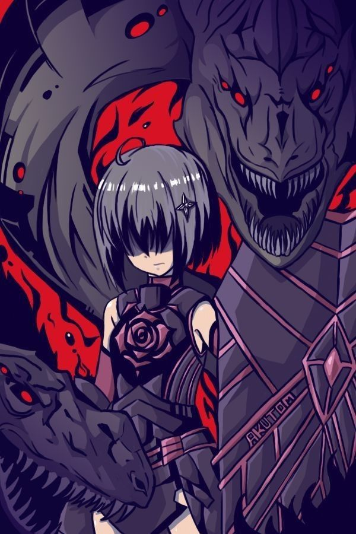

<div align="center">


<a href="https://git.io/typing-svg">
  
</a>

<br/>


</div>

<br/>

## 👤 Profile

<table align="center" border="0">
<tr>
<td width="32%" valign="middle" align="center">
  
  <br/>
  <sub><b>Maple — Honjou Kaede</b></sub>
</td>
<td width="68%" valign="top">

```text
OPERATOR PROFILE
────────────────────────────────────────
Player     : ハヤ (影野士道)
Guild      : 楓の木 (Kaede no Ki)
Class      : Full-Stack Defender
Level      : 19
Username   : @hayaxxdev-bit
Status     : 🟢 Online / Active

SYSTEM STATUS
────────────────────────────────────────
Firewall   : ██████████ 100%
Shield     : ██████████ Integrity OK
Threats    : 0 detected

EQUIPMENT
────────────────────────────────────────
OS         : Kubuntu LTS
Shell      : Zsh
Editor     : VSCodium
Browser    : Firefox

FOCUS AREAS
────────────────────────────────────────
· Full Stack Development
· Game Development
· Computer Science
· Open Source Contribution
```

</td>
</tr>
</table>

<div align="center">

**「防御力に極振りする。」**

*Semua stat dialihkan ke DEF — begitu pula caraku membangun sesuatu: perlahan, kokoh, dan tahan lama.*

</div>

---

## 🧑‍💻 About

```bash
$ cat about.txt

  Anime & manga ........ enthusiast
  Aesthetic ............ cyber / neon
  Waifu ................ Maple (Bofuri) 🍁
  Philosophy ........... "Slow, solid, unbreakable."
  Currently learning ... TypeScript, Docker, Godot, CS

$ echo $MOTTO
Learn Together. Build Together. Share Together. Grow Together.
```

---

## ⚔️ Tech Stack

<div align="center">

**Languages**
<br/>


**Frontend**
<br/>


**Backend & Database**
<br/>


**DevOps & Tools**
<br/>


</div>

---

## 📜 Quest Log — Current Projects

<div align="center">

<!--QUEST_LOG:START-->

<!--QUEST_LOG:END-->

<br/>


</div>

---

## 🧭 Jalur Latihan — Ability List

<table align="center" width="100%" border="0">
<tr>
<td width="33%" valign="top">

#### 🛡️ Mastered
<sub>*(新月 — sudah jadi tameng utama)*</sub>

* JavaScript
* HTML / CSS
* Git & GitHub Actions
* Node.js / Express

</td>
<td width="33%" valign="top">

#### 🌱 Growing
<sub>*(Devour — masih dilatih, tapi mulai kuat)*</sub>

* TypeScript
* React
* Docker
* Linux (Kubuntu)

</td>
<td width="33%" valign="top">

#### 🔍 New Quest
<sub>*(skill baru yang lagi di-farm)*</sub>

* Godot Engine
* Computer Science fundamentals
* Sistem terdistribusi

</td>
</tr>
</table>

---

## 🍁 Waifu Shrine — Maple

```text
CHARACTER FILE
────────────────────────────────────────
Nama       : Maple / Honjou Kaede
Anime      : Bofuri
Build      : 100% VIT — 0% takut kena damage
Signature  : Shield, Devour, & kekuatan absurd
Alasan     : Polos, optimis, dan kebal pesimis
Loyalty    : ████████████████████ MAX
```

<div align="center">

*Kalau ada bug yang nyerang bertubi-tubi, ingat Maple: tenang, pasang tameng, dan terus maju.* 🛡️

</div>

---

## 🎮 Fan Projects — Bofuri Series

| Project | Deskripsi |
|:--|:--|
| [**Maple's Vault**](https://github.com/hayaxxdev-bit) | Proyek web bertema Bofuri |
| [**Maple's Odyssey**](https://github.com/hayaxxdev-bit) | Petualangan web game bertema Maple |
| [**Syrup's Adventure**](https://github.com/hayaxxdev-bit) | Game bertema Syrup si kura-kura |

<sub>⚠️ Ganti link repo & deskripsi dengan yang asli ya.</sub>

---

## 📊 Catatan Pertempuran — GitHub Stats

<div align="center">


<br/><br/>


</div>

---

## 🌸 Tentang 楓の木 (Kaede no Ki)

<div align="center">

**楓の木 bukan tempat untuk berkompetisi.**
Ini adalah tempat berbagi ilmu, saling membantu, membangun hal baru, dan bertumbuh bersama.

*Kode bisa ditulis sendirian — tapi masa depan yang lebih baik dibangun bersama rekan seperjalanan.*

<br/>


<br/><br/>

「知識は共有することで価値になる。」
*Pengetahuan menjadi berharga saat dibagikan.*

</div>


